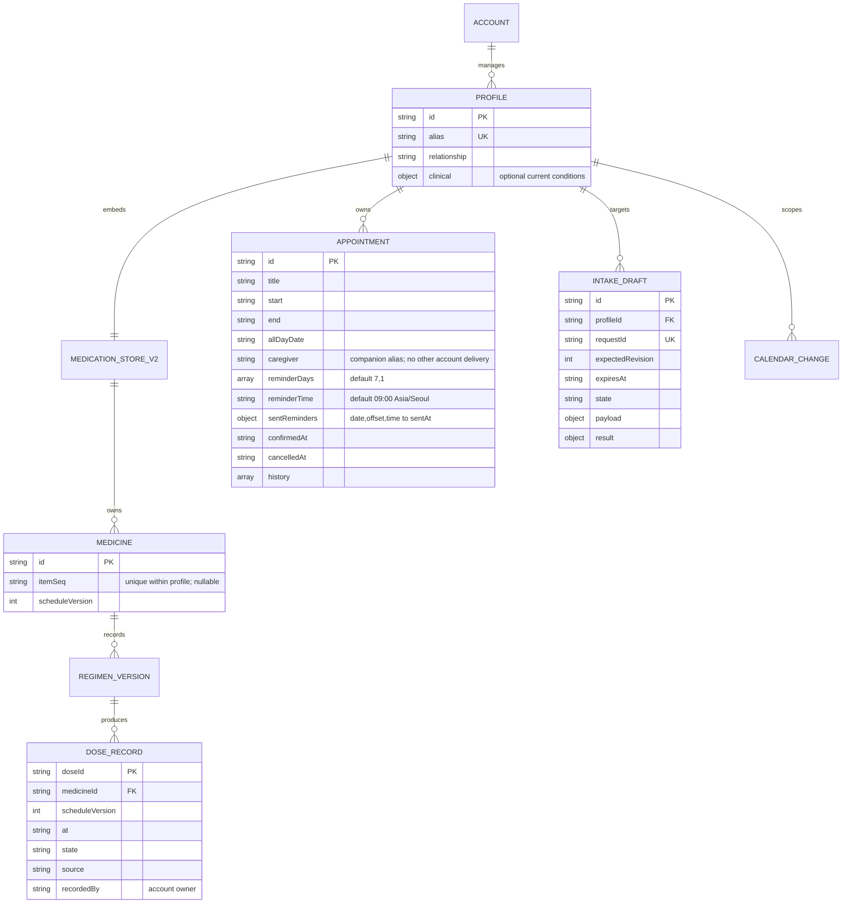

# 가족 원장 v3 논리 ERD

SPEC-FAM-001~003, SPEC-MIG-001, SPEC-VOICE-001~002, SPEC-CAL-001, SPEC-DUR-001의 데이터 계약임. 저장은 Python 표준 라이브러리의 JSON이며 SQL 테이블을 실제로 생성하지 않음. Grok 계정이 관리자 경계이고 별도 회원/로그인 DB는 없음.

- TBL-FAM-001 profile은 JSON의 profiles[id]에 해당한다. 약·복용·알림·등록 요청·캘린더는 각 프로필의 store 안에 분리한다.
- TBL-FAM-002 medicine·TBL-FAM-003 regimen_version·TBL-FAM-004 dose_record는 기존 v2 구조를 유지한다. 삭제 뒤에도 과거 기록을 보존한다.
- TBL-FAM-005 appointment는 profiles[id].appointments에 해당하며 취소는 cancelledAt으로 남긴다. 프로필은 방문 대상이고 caregiver는 동행 별칭이다. 다른 계정 FK/공유 권한은 만들지 않는다. reminderDays·reminderTime에서 계산한 날짜별 발송 기록을 sentReminders에 보존한다. 변경 이력은 이전 날짜·동행·알림 설정을 포함한다. 병원 접수·예약 시스템의 데이터는 없다.
- TBL-FAM-006 intake_draft는 루트 drafts에 해당하고 profileId가 필수다. 미확정 초안으로 약·예약을 만들지 않는다.
- TBL-FAM-007 calendar_change는 각 v2 calendar를 외부 출력에서 profile ID로 구분한다. 외부 event ID와 옛 key의 대응을 보존한다.
- DUR는 공식 참조 자료의 요청별 조회 결과이며 환자 정보를 담은 새 DB 표를 만들지 않는다. 구조화 결과는 지정한 출력 파일에만 저장할 수 있다.

위 대응은 논리 엔티티의 식별자이며 SQL DDL이 아니다. 기존 v2→v3 이관은 약 ID·복용 기록·캘린더 event ID를 유지하고 변환 전 JSON을 state/backups에 보존한다.
