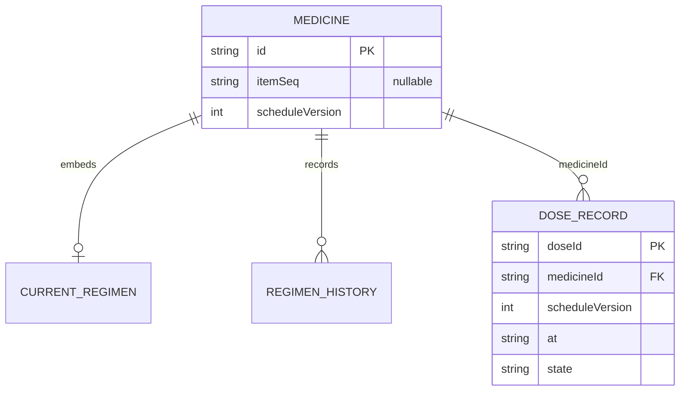
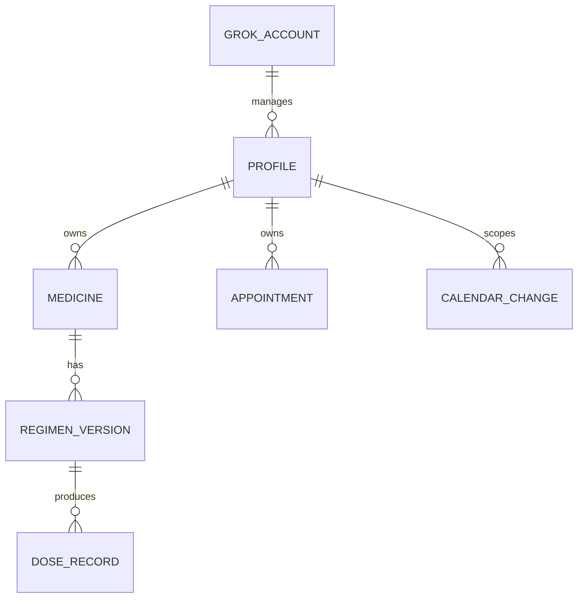

# 필받음 기능 비교와 가족·음성 확장 검토

> 이 문서는 확장 승인 전의 비교 기록이다. 사용자가 가족 프로필·음성/텍스트 등록·DUR·동행 방문 사전 알림을 승인했으며 현행 계약은 [v3 명세](family-v3.md)와 [ERD](05-erd/family-v3.md)다. 아래 ‘현재’·‘초안’은 검토 당시 상태를 뜻한다.

상태: **현행 확인 + 확장 설계 초안**. 현재 구현을 가족 프로필·DUR 지원 완료로 바꾸는 문서가 아님. 운영 원장·캘린더·봇 스킬은 이 검토로 변경하지 않음.

## 검토 근거

- 사용자 요청(2026-11-01, 이 Codex 대화): “필받음의 약봉이가 할 수 있는 기능 다 할 수 있는거지? (가령 타이레놀이랑 인데놀이랑 먹어도 돼? 등등)”, “말로도 약/캘린더 등 등록”, “필받음처럼 프로필별로(엄마가 할머니 약 챙기는 경우 있음)”, ERD 준비 여부와 다른 설계의 이유를 질문함.
- 눈물이그록그록 코드 기준: [23d8444](https://github.com/kodonghui/nunmul-grokgrok/tree/23d84445837b009fbae945db3d82a5f39f049141). 약 목록 v2·조회 중계와 테스트 153개가 범위임.
- 필받음은 보관본 README가 가리킨 현재 팀 저장소 [NoPill-NoFeel/PillSoGood](https://github.com/NoPill-NoFeel/PillSoGood/tree/9b5b5efa6fe14f9d8f966b9ad80982a85203f2b0)의 main 9b5b5ef를 확인함. 이는 소스 검토이며 배포 서버 실행 버전·의학적 정확도의 검증이 아님.
- 사용자 전달 Grok 보고(14:07): main 23d8444, 테스트 153개 통과, 중계 경유 이름 검색·설명 모두 OK, itemSeq=202106092, e약은요 updateDe=2026-06-29. 그록 로그를 Codex가 직접 조회한 것은 아님. URL을 해당 명령에서만 설정했다고 하므로 이후 스킬 실행에서도 동일한 중계 설정이 적용되는지 별도 확인이 필요함.

## 현재 기능 차이

| 항목 | 필받음 소스 | 현재 눈물이그록그록 |
| --- | --- | --- |
| 공식 약 검색·설명 | 허가정보·e약은요 근거 수집 | 허가정보 후보·e약은요 설명 구현, 그록 중계 성공 보고까지 수신 |
| 내 약·복약 일정 | 회원 소유 프로필별 내 약·일정 | 약별 누적·일정 변경·중단·일정 삭제·목록 제외 구현, 프로필 구분 없음 |
| 병용 질문 | DurLookupService·DurEvaluator가 품목코드/공식 DUR를 대조하고 AnswerGenerator가 그 결과로 안내 | DUR 조회·제품 쌍 대조 없음. e약은요 intrcQesitm 조회는 있으나 두 약의 병용 점검을 대신하지 않음 |
| 프로필 조건 DUR | 병용·연령·노인·임부 4유형, 실패/부분 확인·조건 미확인을 구분 | 없음. 나이·임신 여부 등의 프로필 정보도 저장하지 않음 |
| 자연어·음성 일정 | Live 대화·확인 초안·대상 소유권 확인·수정/삭제/중단 경로가 있음 | 그록 앱의 음성 입력/통화와 직접 입력 스킬을 이용할 수 있으나 약 등록 전체 음성 시연은 미검증. 자체 음성 엔진·가족 대상 해석은 없음 |
| 복용 완료·울보 재촉 | 서버 README는 실제 복용 완료 기록을 범위에서 제외한다고 명시 | TAKEN/MISSED/SKIPPED·부분 확인·재촉 단계 구현 |
| 일반 병원 예약 | 이번 검토에서 필받음의 범용 외부 캘린더 예약 지원을 확인한 것은 아님 | 그록 Calendar 앱은 일정 생성 가능. 우리 도구는 복약·자동 재방문 일정이며 프로필에 연결된 일반 예약 관리 도구는 없음 |

필받음도 ‘모든 병용이 안전한지 결정하는 모델’로 구현한 것이 아님. 공식 근거·조회 범위·대조 결과를 분리하며 NONE을 복용 안전성 보장으로 표현하지 않도록 함. 이 검토는 타이레놀·인데놀의 실제 병용 가능 여부에 답한 것이 아님.

소스: [AnswerGenerator](https://github.com/NoPill-NoFeel/PillSoGood/blob/9b5b5efa6fe14f9d8f966b9ad80982a85203f2b0/pillbadeum-server/src/main/java/org/semiproject/pillbadeumserver/chat/service/AnswerGenerator.java), [DurLookup](https://github.com/NoPill-NoFeel/PillSoGood/blob/9b5b5efa6fe14f9d8f966b9ad80982a85203f2b0/pillbadeum-server/src/main/java/org/semiproject/pillbadeumserver/chat/service/DurLookup.java), [DurEvaluator](https://github.com/NoPill-NoFeel/PillSoGood/blob/9b5b5efa6fe14f9d8f966b9ad80982a85203f2b0/pillbadeum-server/src/main/java/org/semiproject/pillbadeumserver/chat/service/DurEvaluator.java), [ProfileService](https://github.com/NoPill-NoFeel/PillSoGood/blob/9b5b5efa6fe14f9d8f966b9ad80982a85203f2b0/pillbadeum-server/src/main/java/org/semiproject/pillbadeumserver/profile/service/ProfileService.java), [Live 일정 문서](https://github.com/NoPill-NoFeel/PillSoGood/blob/9b5b5efa6fe14f9d8f966b9ad80982a85203f2b0/pillbadeum-server/docs/MEDICATION_LIVE.md).

## 현행 데이터 관계와 설계 이유

현행에는 JSON 계약 [my-meds-v2.md](my-meds-v2.md)와 중계 OpenAPI가 있고, 별도 ERD·SQL DDL·가족 프로필 명세는 없었음. 다음은 현재 코드를 이번에 정리한 **논리 관계도**이며 SQL 테이블을 뜻하지 않음.

- medicines 아래 schedule/history를 두고 doses는 약 ID·일정 버전·시각에 연결됨. reminders와 calendar는 시각 key로 묶은 별도 원장임.
- 필받음은 회원·프로필·내 약·대화 등 MySQL 관계 모델이고, 눈물이그록그록은 그록이 대화·음성·Google 로그인을 맡으며 Python이 JSON 원장과 계산을 맡는 구조임.
- 초기 사용자 조건이 표준 라이브러리·JSON 파일·한 봇의 빌드데이 시연이었으므로 MySQL/Java/별도 회원 서버를 두지 않았음.
- 약별 일정 버전·복용 기록·캘린더 반영 대기는 울보 재촉과 외부 캘린더 재시도를 위해 추가한 개념임. 필받음 데이터베이스를 그대로 복제하지 않았음.
- 이 선택은 저장 방식의 이유이며, 가족 격리나 DUR가 이미 구현됐다는 근거는 아님. 가족 확장 전 관계·키·이관 계약을 보완해야 함.

## 가족·음성 확장 초안

우선 한 그록 계정에서 여러 가족의 약을 관리하는 범위로 해석함. 서로 다른 계정의 초대·공유·권한 위임은 별도 범위임. 엄마가 그록 이용자이면서 할머니 약을 챙긴다면 엄마는 관리자/기록자이고 할머니는 복용 대상 프로필임. 두 역할을 같은 프로필로 섞지 않음.

GROK_ACCOUNT는 플랫폼의 계정 경계이며 새 로그인 DB를 만든다는 뜻이 아님. APPOINTMENT는 복약 자동 재방문 외에 사용자가 직접 말한 일반 병원 예약이 필요할 때의 개념임. 모든 항목은 제안이며 아직 구현하지 않았음.

| ID | 요구/동작 | 예외·검증 기준 | 상태 |
| --- | --- | --- | --- |
| SPEC-FAM-001 | REQ-FAM-001: 별칭·관계로 가족 프로필 생성·선택·목록 | 이름·생년월일·주소·병원 개인정보는 이번 범위에서 수집하지 않음. 나이·임신 조건이 없으면 UNKNOWN으로 취급 | 초안 |
| SPEC-FAM-002 | REQ-FAM-002: 모든 약 등록·수정·중단·확인·재촉에 profileId 적용 | 한 프로필에서 같은 품목 중복 방지, 다른 프로필의 같은 품목은 허용. 프로필과 약 소속 불일치는 거부 | 초안 |
| SPEC-FAM-003 | REQ-FAM-002: 같은 시각도 프로필별 알림·캘린더 구분 | 엄마와 할머니가 17시에 약이 있어도 하나의 mark가 다른 프로필을 바꾸지 않음. key와 제목에 프로필 구분. 초기 캘린더는 기존 ‘눈물이 테스트’ 범위 유지 | 초안 |
| SPEC-VOICE-001 | REQ-VOICE-001: 음성 전사와 텍스트를 동일한 명령 초안으로 해석 | 대상 프로필·제품·함량이 모호하면 한 번에 질문. 현재 날짜/내일은 Asia/Seoul 실제 시각 기준. 발화자와 복용 대상이 같다고 가정하지 않음 | 초안 |
| SPEC-VOICE-002 | REQ-VOICE-001: 확인된 초안만 도구로 저장 | 초안에 profileId·항목·revision·requestId 고정. 정정하면 이전 초안 무효화. 명확한 실행 요청은 반복 승인하지 않음. 통화/채팅 재전달에도 한 번만 저장 | 초안 |
| SPEC-CAL-001 | REQ-CAL-001: 말로 받은 병원 예약을 해당 프로필 일정에 등록·수정·취소 | 날짜·시각·대상·기간을 확인하고 실제 Calendar 성공 후 완료 보고. 약 복용 일정과 일반 예약의 key를 분리 | 초안 |
| SPEC-DUR-001 | REQ-DUR-001: 공식 품목이 확정된 두 약/한 프로필 약 목록의 DUR 대조 | 정확한 제품·함량 확인, 상대 품목코드 대조, 전체 페이지·출처·갱신일 확인. ALL/PARTIAL/FAILED와 FOUND/NONE/UNKNOWN 분리. NONE을 안전으로 바꾸지 않음 | 초안 |
| SPEC-MIG-001 | REQ-FAM-002: 기존 v2 약·TAKEN·일정 버전·캘린더 ID 보존 이관 | 기존 소유 대상을 추측하지 않고 ‘기존 약’ 프로필에 보존하거나 확인된 대상으로 배정. 구 key와 외부 event ID 연결을 유지해 중복 생성 방지. 실패 시 이전 원장 보존 | 초안 |

필수 변경점:

- 중복·등록 requestId·재촉·캘린더 key를 프로필 범위로 바꿈. medicineId만 추가하고 현재의 전역 YYYY-MM-DD|HH:mm 묶음을 남기는 방식은 사용하지 않음.
- 기본 ‘먹었어’의 대상이 모호하면 전체 가족을 mark하지 않음. 복용 대상과 기록한 관리자를 구분함. 기본 알림 수신자는 현재 그록 계정이며 가족에게 별도 메시지를 보내는 기능으로 확대하지 않음.
- 음성 원문·녹음은 저장하지 않고 확인된 구조화 값만 도구에 전달함. 그록의 기본 음성 기능을 이용하므로 별도 음성 서버를 자동 도입하지 않음.
- DUR는 현재 노트북 중계의 permit/explain 허용 목록에 없음. 별도 조회 계약·실제 API 활용 승인·실연동·오프라인 실패 테스트를 추가해야 함. e약은요 설명만 읽고 병용 점검 완료로 표시하지 않음.
- 프로필별 임상 조건의 수집·보관 범위는 별도 결정이 필요함. ‘할머니’라는 별칭으로 나이를 추정하거나 미확인 임신 여부를 false로 저장하지 않음.
- 서로 다른 가족 계정이 같은 약 목록에 접근하려면 사용자 식별·소유권·공유 동의·권한 검증을 따로 설계해야 함. 프로필 별칭은 접근 제어가 아님.

구현 순서 제안: 프로필/가족 범위 확정 → 논리 ERD·v3 키·이관 계약 → 프로필 격리 도구·테스트 → 음성/텍스트 등록·예약 흐름 → DUR 계약·조회·대조·답변 테스트. 현재 153개 테스트는 새 가족·DUR 기능의 검증으로 계산하지 않음.

앱 음성 기능 근거: [Grok Bot 메시지·음성 안내](https://docs.x.ai/grok-bot/chat-and-collaboration). DUR의 의미와 범위: [심평원 국민 체험관](https://www.hira.or.kr/ra/medi/form.do?pgmid=HIRAA030029000000). 문서 확인은 실제 음성 시연이나 의료적 판단을 대신하지 않음.
